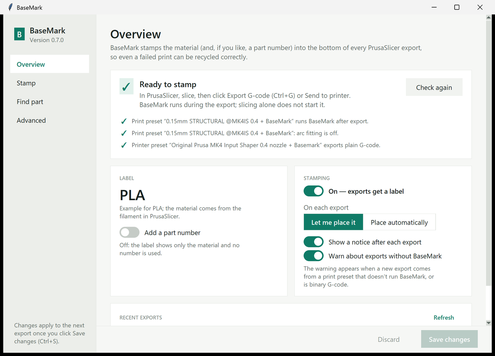
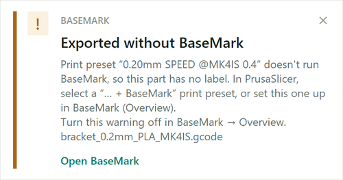

# BaseMark

**Material identity, printed in.** BaseMark is a small add-on for PrusaSlicer that writes the
material, such as `PLA` or `PETG`, into the underside of every part you print. Even a failed
print or a loose part found on a shelf can then be sorted into the right recycling bin.

It works on the exported G-code: in the first two layers it leaves out the plastic where the
letters go, so the label is a shallow recess you read from below. The rest of the print is
not changed.

Built at the UBC IGEN 3D Print Shop by Sebastians Krols. PrintMark is the repository;
BaseMark is the application.

> **Status: v0.8 lab pilot.** The software is tested; physical results are not yet
> qualified. Print a test part on each printer and material before relying on it
> ([lab test plan](docs/lab-validation.md)).


## What it does

- **Labels every part on the plate.** Each part gets its own `PLA`; parts too small for a
  label are left unstamped, and the notice says so.
- **Runs by itself.** It starts when you click **Export G-code** (or **Send to printer**) in
  PrusaSlicer, not when you slice. A window shows where the labels go; press **Enter** to
  accept. It can also place them automatically without asking.
- **Tells you the result.** A small notice in the screen corner says *Stamped PLA* or why
  an export was left unchanged.
- **Warns about missed exports.** If someone exports with a print preset that isn't set up
  for BaseMark, a warning appears, so unlabelled parts aren't missed. It can be turned off.
- **Optional part numbers.** Switch them on for `PLA 001`, `PLA 002`, … and look any number
  up later under **Find part**.
- **Fails safe.** If BaseMark cannot handle a file with certainty (unusual G-code, too
  little solid area), it leaves the file exactly as PrusaSlicer made it.
- **Free for noncommercial use.** Hobbyists, student teams and schools use it for free;
  businesses need a license. See [License and commercial use](#license-and-commercial-use).

## Install (Windows)

1. While signed in to GitHub with access to this private repository, open
   [**Releases**](https://github.com/seb-krols/PrintMark/releases) and download the newest
   `basemark-…-windows-x64-setup.exe`.
2. In PrusaSlicer, select the printer and print preset you normally use, then **close
   PrusaSlicer**.
3. Run the installer. Keep **Connect PrusaSlicer now** ticked and click **Install**.

That's it. The installer needs no administrator rights or Python. It installs to
`%LOCALAPPDATA%\Programs\BaseMark`. In PrusaSlicer it adds `… + BaseMark` copies of your
selected presets and selects them. Your own presets are not changed. BaseMark then opens and
should say **Ready to stamp**. Upgrades keep all settings and history.

<details>
<summary>Windows warning, checksums, unattended install, portable ZIP</summary>

The build is not code-signed, so Windows may say *Windows protected your PC*: choose
**More info → Run anyway** after checking the file came from this repository. To verify a
download, `Get-FileHash .\basemark-…-setup.exe` must match the `.sha256` file next to it.

Unattended install: `basemark-…-setup.exe /VERYSILENT` (PrusaSlicer closed; add
`/CONNECT=no` to leave PrusaSlicer alone). A portable ZIP is attached too; keep its `.exe`
files and the `_internal` folder together. The [installation guide](INSTALL.md) covers manual
setup, upgrades and removal.
</details>

## First test (about 10 minutes)

1. **Open BaseMark** from the Start menu. The **Overview** must say **Ready to stamp**.
   If not, close PrusaSlicer and click **Set up PrusaSlicer**.
2. **Slice the test part.** In PrusaSlicer, import
   `%LOCALAPPDATA%\Programs\BaseMark\examples\basemark-coupon.stl`, slice, and click
   **Export G-code**.
3. **Confirm the label.** The *Stamp this export* window opens. Press **Enter**.
4. **Check the result.** A corner notice says *Stamped PLA*. Open the exported file in
   PrusaSlicer's **G-code Viewer** (File → G-code preview): the first layers show the
   mirrored text as gaps. The normal slicer preview still shows the paths from before
   BaseMark.
5. **Print it** under normal supervision and read the label on the underside.



## Everyday use

### The export window

PrusaSlicer waits while this window is open. Everything is shown **from below**, as you will
read it on the part.

| To | Do |
| --- | --- |
| Accept all labels | **Enter** or the green button |
| Move a label | Drag it |
| Make it bigger or smaller | **+** / **−** (3 mm by default, down to 2 mm by hand) |
| Turn it 90° | **R** |
| Let BaseMark choose again | **A** (Auto place) |
| Pick another part | Click it, or **Tab** |
| Leave one part without a label | Select it, switch off **Stamp this part** |
| See a small part up close | **Z** or double-click (Zoom to this part) |
| Export without any label | **Esc** (Skip) |

A label must fit entirely inside the part's solid area (it turns red if not). Prefer no
questions? Choose **Place automatically** on the Overview.

### Plates with several parts

Every part on the plate gets a label, placed on its largest flat area. Parts are told apart
by PrusaSlicer's **Label objects** option (Print Settings → Output options), which Prusa's
own printer profiles have on. Without it, every separate patch of first-layer plastic counts
as a part, so a part with several feet may get several labels. If you prefer one label per
plate, switch off **Every part on the plate** on BaseMark's **Stamp** page; then only the
largest part is labelled.

### Notices

After each export a notice appears in the screen corner for a few seconds:

- **Stamped PLA**: done. With several parts it says how many, e.g. *Stamped PLA on 2 of 3
  parts* when one part had no room.
- **Export not stamped**: the reason is shown (part too small, arc moves, …). The file was
  exported unchanged.
- **Exported without BaseMark**: the export came from a print preset that doesn't run
  BaseMark, or was binary G-code. Select a `… + BaseMark` preset, or set the preset up in
  BaseMark.



The last warning comes from a small background check that starts with Windows. It looks
only at new G-code files in PrusaSlicer's export folders, your Downloads and Desktop. It
cannot see uploads with **Send to printer**, which leave no file on the PC. Both kinds of
notice can be switched off on the Overview.

### Part numbers and Find part

Switch on **Add a part number** (Overview) for labels like `PLA 001`. Every export then uses
the next number. Every part on that plate carries the same number, and BaseMark records the
export: time, material, file name, objects and a checksum of the file. To identify a part,
open **Find part** and type the number exactly as printed, e.g. `042`. Without part numbers
nothing is counted or recorded.


Settings change only when you click **Save changes** (Ctrl+S). Closing with unsaved changes
asks first.

## Text size and small parts

The default text is **3 mm** tall (capital letters). The label is a gap in the bottom-layer
lines, which are about 0.45 mm wide with a 0.4 mm nozzle. At 3 mm the letter strokes are
about 0.55 mm and the holes inside letters such as *A* about 1 mm, just enough to stay open.
Smaller text starts to fill in. Common 3D-printing guidance agrees: about 4 mm for text on a
bottom face, with 2 mm failing and 3 mm marginal for embossed text.

| Label | Text size | Smallest flat bottom (1.5 mm edge margin) |
| --- | --- | --- |
| `PLA` | 7.3 × 3 mm | about 10 × 6 mm |
| `PETG` | 9.9 × 3.1 mm | about 13 × 6 mm |
| `PLA 001` | 15.2 × 3.1 mm | about 18 × 6 mm |

Smaller parts are left without a label (and the notice says so). For an occasional small
part, the **−** button goes down to 2 mm. Print a test first: below 3 mm the letters may not
be readable. A part with a 1 × 2 mm base cannot carry any letter.

## What BaseMark skips

A skipped export is never changed. The notice and the Overview show the reason.

| Skip reason | What to do |
| --- | --- |
| *G2 is unsupported* | Turn arc fitting off (Print Settings → Advanced). `… + BaseMark` presets already have it off. |
| *binary/packaged G-code* | Use plain G-code (Printer Settings → General → Firmware). `… + BaseMark` printer presets already do. |
| *does not fit* / *no solid surface* | The bottom is too small, has too many holes, or has fewer than 3 solid bottom layers. |
| *multiple tools* | Multi-material and multi-tool prints are not supported yet. |
| *non-increasing layers* / *non-planar* | Sequential printing ("complete objects") and vase mode are not supported. |

The full list of supported G-code is in the [reference](docs/reference.md#supported-g-code).

## Troubleshooting

**Nothing happens on export.** Slicing alone does not run BaseMark: click **Export G-code**
(Ctrl+G). Then click **Check again** on the Overview. It reads PrusaSlicer's *saved* presets
and lists what is missing. Changes in PrusaSlicer only count once the preset is saved, and
opening a `.3mf` project can switch back to the presets stored in it.

**The export window is hidden.** It stays on top and flashes in the taskbar if Windows
doesn't let it take focus. PrusaSlicer waits until you press Enter or Esc.

**Something else.** See the [installation guide](INSTALL.md#troubleshooting) and, for a
stopped export that left a record half-written, [recovery](docs/recovery.md).

## Tested with

Software checks with the test part (plain G-code, arc fitting off) through the real slicer:

| PrusaSlicer | Stock printer profiles that stamp |
| --- | --- |
| 2.9.6 | MK4S (PLA, PETG), CORE One, MK4 Input Shaper, MK3.9S, XL Input Shaper (single tool), MINI Input Shaper, i3 MK3S |
| 2.7.4 | MK4 / MK4 Input Shaper (PLA, PETG, plates of several parts), MK3.9, XL, MINI, i3 MK3S |
| 2.8.1 | Regression fixtures and i3 MK3S hook (Linux) |

Bambu printers have not been tested yet. None of this replaces printing test parts.

## License and commercial use

BaseMark is **free for noncommercial use and paid for commercial use**. It is
*source-available* under the
[PolyForm Noncommercial License 1.0.0](https://polyformproject.org/licenses/noncommercial/1.0.0/):
anyone may read, use and change the code, but not to make money with it.

| Who | Cost | What to do |
| --- | --- | --- |
| Hobbyists, makers, clubs | Free | Just install it. |
| Student groups and design teams | Free | Just install it; ask for a free key if 100 stamps a month is not enough. |
| Schools, universities, makerspaces, charities, public bodies (noncommercial work) | Free | As above. |
| Businesses, print services and print farms, anyone selling prints or products made with it | Paid license | Contact the author before use. |

**Monthly limit.** Without a license key, BaseMark stamps up to **100 exports per calendar
month**. The *Stamped* notice counts down the last 20. After that, exports are saved
**unchanged** and the notice says whom to contact; stamping starts again next month. A
license key removes the limit: enter it under **Advanced → License**. The Overview always
shows the current count.

**Get a key or a commercial license:** email **sebastians.krols@gmail.com** with your
organisation, what you print, and roughly how many exports a month.

The limit is a friendly reminder, not copy protection; the [LICENSE](LICENSE) is what counts.
[LICENSING.md](LICENSING.md) explains the terms in plain language, with examples.

## More documentation

- [Installation guide](INSTALL.md): manual setup, upgrades, removal, troubleshooting.
- [Reference](docs/reference.md): every setting, filament-note overrides, command line,
  record files, supported G-code.
- [Lab test plan](docs/lab-validation.md), [verification record](docs/verification.md),
  [recovery](docs/recovery.md), [architecture](docs/architecture.md),
  [roadmap](docs/roadmap.md), [changes](CHANGELOG.md).

## Development

```sh
uv sync --extra dev
uv run basemark --demo        # the export window with a sample plate
uv run basemark --settings    # the BaseMark app
uv run pytest
uv run ruff check .
```

Python 3.11+ with Tk. Windows installers are built locally with
`scripts\build_windows.ps1` and attached to Releases, because GitHub Actions currently stops
before any job starts (see [verification](docs/verification.md)).

BaseMark works offline: no accounts, cloud service or telemetry; the license check and the
monthly count stay on the PC. The bundled Lato Bold font keeps its
[SIL Open Font License](src/basemark/assets/OFL.txt); see
[third-party notices](THIRD_PARTY_NOTICES.md).
BaseMark subtracts toolpaths; it does not reslice, so very fine lettering can soften. The
label is only as accurate as the filament selected in PrusaSlicer, and is not a material
certification.
