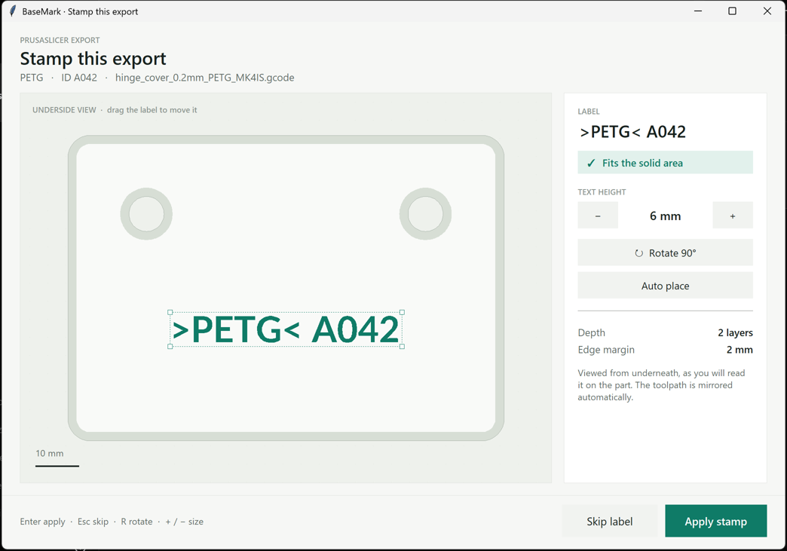
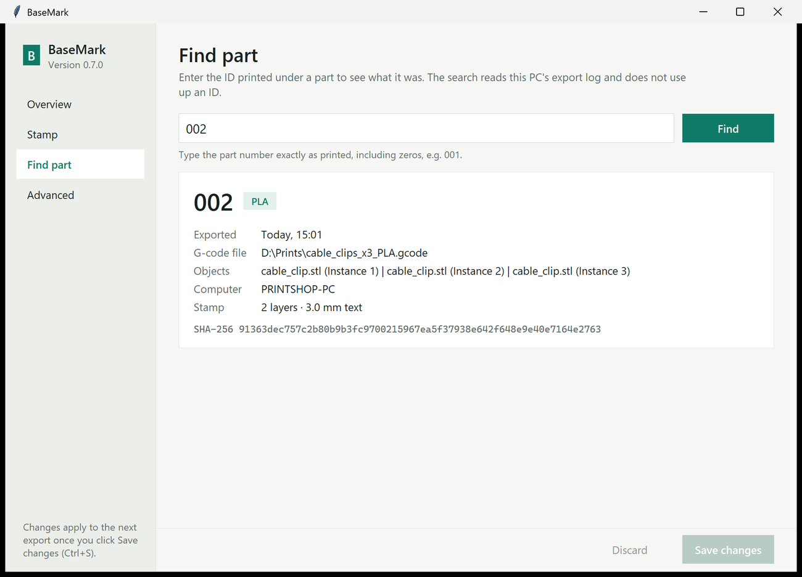
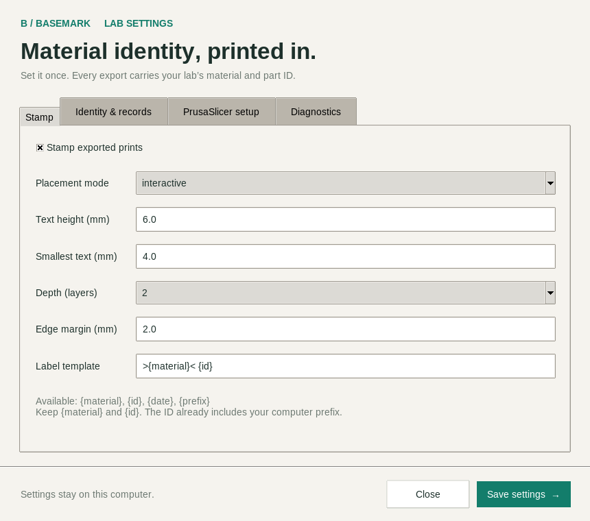
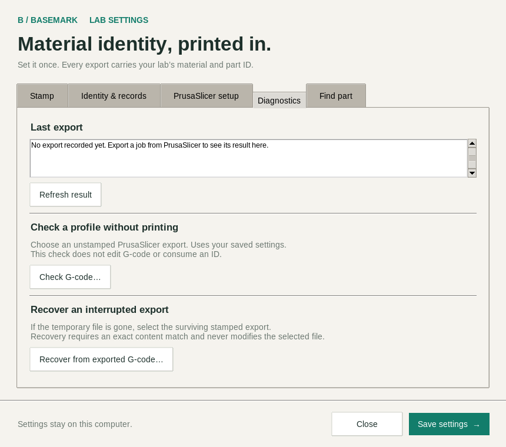

# PrintMark / BaseMark

**Material identity, printed in.** Automatic material and part-ID stamps for PrusaSlicer.

BaseMark removes small sections of extrusion from the bottom layers of a part to mark it
with its selected filament and a running identifier, such as `>PETG< A042`. Even a failed
print that retains its stamped base can carry its material identity into the recycling stream.

Built at the UBC IGEN 3D Print Shop by Sebastians Krols.

**Status: v0.5 lab pilot.** PrintMark is the repository; BaseMark is the application name.
Software verification is separate from physical qualification: check every printer, profile
and sheet with real coupons before routine use. This is not yet a production-qualified tool.



## Download (Windows)

1. While signed in to GitHub with access to this private repository, open
   [**Releases**](https://github.com/seb-krols/PrintMark/releases) and pick the newest
   `BaseMark … Windows pilot`.
2. In PrusaSlicer, select the printer and print profile you normally use, then **close
   PrusaSlicer**.
3. Download and run `basemark-0.5.0-windows-x64-setup.exe`. It has one page: type this PC's
   **prefix** (`A`, `B`, …) and keep **Connect PrusaSlicer now** ticked, then click **Install**.
   It installs per user to `%LOCALAPPDATA%\Programs\BaseMark` (no administrator rights, no
   Python), adds `… + BaseMark` copies of the selected presets and selects them. BaseMark
   opens and should say **Ready to stamp**.

**Several shop PCs:** run the installer silently with that PC's prefix, e.g.
`basemark-0.5.0-windows-x64-setup.exe /VERYSILENT /PREFIX=B` (PrusaSlicer closed). Add
`/CONNECT=no` to leave PrusaSlicer alone. Upgrades keep the prefix, IDs and settings.

The build is unsigned, so Windows SmartScreen may say *Windows protected your PC*: choose
**More info → Run anyway** after checking the file came from this repository. To verify it:
`Get-FileHash .\basemark-0.5.0-windows-x64-setup.exe` must match the `.sha256` file.
A portable ZIP is attached too; keep its `.exe` files and `_internal` folder together.

## First test with PrusaSlicer (about 10 minutes)

1. **Check the prefix.** Open **BaseMark** from the Start menu. *This computer* on the
   **Overview** shows the prefix from the installer; change it there if needed (it saves
   automatically).
2. **Check PrusaSlicer.** The Overview must say **Ready to stamp**. If not (for example
   PrusaSlicer was open during install, or you want another print profile), select the
   profile in PrusaSlicer, **close PrusaSlicer** and click **Set up PrusaSlicer**. It adds
   `… + BaseMark` copies of those presets with the hook on, arc fitting off and plain (not
   binary) G-code, and selects them. Your existing presets are not changed.
3. **Slice the coupon.** Open PrusaSlicer, import
   `%LOCALAPPDATA%\Programs\BaseMark\examples\basemark-coupon.stl`, slice, then click
   **Export G-code**. The *Stamp this export* window opens during the export (not when
   slicing): drag the label if you like (**+/−** size, **R** rotate), then **Enter** to apply
   or **Esc** to skip.
4. **Check the result.** A notice in the screen corner confirms *Stamped >PLA< A001*, or
   says why the export was left unchanged. The Overview lists it under *Recent exports*.
   Open the exported file in **PrusaSlicer G-code Viewer** (File → G-code preview): the first
   layers show mirrored text-shaped gaps, with a solid layer above. The normal slicer preview
   still shows the toolpaths from before BaseMark.
5. **Find it again.** **Find part**, then enter the printed ID (e.g. `A001`).
6. **Print it** under normal supervision, then follow the [lab test plan](docs/lab-validation.md).

**Nothing happened?** Slicing alone does not run BaseMark: it runs only when you click
**Export G-code** (Ctrl+G) or **Send to printer**. If it still does nothing, click
**Check again** on the Overview. It reads PrusaSlicer's
*saved* presets and lists anything still missing. Changes made inside
PrusaSlicer only count once the preset is saved, and opening a `.3mf` project can switch
back to the presets stored in that project. If the result says *skipped*, the message names the
cause: for example `G2 is unsupported` (arc fitting on) or `binary/packaged G-code`.
Skipped exports are left unchanged and consume no ID. The [installation guide](INSTALL.md)
covers manual setup, troubleshooting, upgrades and removal. For scripted lab setup:
`basemark.exe --setup-prusaslicer` / `--check-prusaslicer` (exit 2 = not ready).

### Tested slicer profiles

Software checks with the coupon (plain G-code, arc fitting off) through the real slicer:

| PrusaSlicer | Stock printer profiles that stamp |
| --- | --- |
| 2.9.6 | MK4S (PLA, PETG), CORE One, MK4 Input Shaper, MK3.9S, XL Input Shaper (single tool), MINI Input Shaper, i3 MK3S |
| 2.7.4 | MK4 / MK4 Input Shaper (PLA, PETG), MK3.9, XL, MINI, i3 MK3S (PLA, PETG; through the installed hook) |
| 2.8.1 | Regression fixtures and i3 MK3S hook (Linux) |

Bambu printer profiles have not been tested yet. None of this replaces printing coupons.

## Placement window

PrusaSlicer waits for the placement window. Drag the stamp, use **+/−** to resize,
**R** to rotate 90°, or choose **Auto place**. **Enter** applies; **Esc** or **Skip label**
exports unchanged and consumes no ID. Both the footprint and text are shown **from below**.
The G-code itself contains mirrored text. A missing display falls back to auto placement.
Automatic placement tries horizontal and 90° orientations at each size before shrinking,
so tall, narrow parts can retain full-size lettering.

## Find a part from its printed ID

Open **BaseMark → Find part** and enter the complete ID, such as `A042`. The result shows the
material, export time, filename, object names, computer and output hash from the saved CSV.
Search is exact and case-sensitive; prefixes and leading zeros matter. It reads the local log,
so use the originating PC or a copy of its CSV. It records an export, not proof of a finished print.

```sh
basemark --lookup A042
basemark --lookup A042 --json
basemark --log-file /path/to/copied-log.csv --lookup A042
```

Lookup does not change files or consume an ID. Exit 0 means found; exit 1 means not found or
the log could not be read (check stderr). Duplicate legacy records are all displayed explicitly.



## Develop or try it from source

```sh
uv sync --extra dev
uv run basemark --demo
uv run basemark --settings
uv run pytest
uv run ruff check .
```

Python 3.11+ and Tk are required for source installations. On Linux, install your distribution's
Python Tk package if necessary. `uv` is optional: `python -m pip install -e '.[dev]'` also works.

```sh
# SVG preview: no G-code modification and no counter increment
basemark --mode auto --dry-run --preview-output preview.svg job.gcode

# Stamp a copy for inspection
basemark --mode auto --prefix A job-copy.gcode

# Per-job opt-out (bypasses even an invalid config)
basemark --off job.gcode

# Run from PrusaSlicer once to check actual profile/environment values
basemark --dump-env job.gcode
```

Run `basemark --help` for arguments. The input path is the **last argument** when invoked
by PrusaSlicer. Its temporary file is atomically replaced only after all validation succeeds.
Standalone use reads PrusaSlicer's embedded config if environment variables are absent.

## Settings

Precedence: **built-in defaults → TOML config → filament notes → CLI arguments**.

Config locations:

- Windows: `%APPDATA%\BaseMark\config.toml`
- Linux/macOS: `~/.config/basemark/config.toml` (respects `XDG_CONFIG_HOME`)
- Any OS: `--config /path/to/config.toml`

The settings window writes the TOML file. A complete example is [examples/config.toml](examples/config.toml).
Filament notes can contain `basemark: layers=2; size=6; label=PETG`. `label` is an explicit
operator override; use it only when it accurately describes the filament. Material aliases
can also be configured with `material_map = { PET = "PETG" }`.



| Setting | Default | Meaning |
| --- | --- | --- |
| `enabled` | `true` | Master switch |
| `mode` | `"interactive"` | Placement popup or `"auto"` |
| `template` | `">{material}< {id}"` | Requires material and ID; also supports date and prefix |
| `text_height_mm` | `6.0` | Font cap height, 4–12 mm |
| `min_text_height_mm` | `4.0` | Minimum auto-shrink size |
| `layers` | `2` | Recess depth, 1–3 layers |
| `margin_mm` | `2.0` | Distance from first-layer edges/holes; at least 0.5 mm |
| `counter_prefix` | `""` | Unique computer identifier |
| `counter_digits` | `3` | Minimum zero-padding; never truncates larger IDs |
| `counter_next` | `1` | Starting value / lower bound; stored counter is authoritative |
| `counter_file` | `""` | Defaults to `counter.json` next to config |
| `log_file` | `""` | Defaults to `log.csv` next to config |
| `material_map` | `{}` | Explicit filament-name aliases |
| `label` | `""` | Optional explicit material-name override |
| `notify` | `true` | Corner notice after each export (stamped or why not) |

Relative counter/log paths resolve beside the config file. Use **local disks** for this pilot;
network shares and cross-machine coordination are outside this release. The counter cannot
be moved backwards through settings. For a new numbering series, choose a new prefix and
counter file. `{id}` includes the prefix; `{prefix}{id}` will deliberately repeat it.

The CSV records ID, UTC time, material, final export name when available, object comments,
hostname, layer count, text height, removed filament length and output SHA-256. A journal
recovers interruptions between file replacement and counter/log updates. See
[recovery procedures](docs/recovery.md) before manually altering counter files.
Before replacing G-code, BaseMark checks that the CSV is readable and the proposed ID is not
already recorded. Losing/resetting a counter therefore cannot reuse an ID present in that log.
Keep the history backed up: this check cannot detect IDs from a deleted or different CSV.

The **Overview** shows the last export result and recent exports. **Advanced** checks an
original G-code file without consuming an ID and recovers interrupted audits from an exact
matching final export.
`basemark --check job.gcode` performs the same compatibility check (exit 2 on unsupported input).



`--dump-env` writes relevant slicer variables to `environment.json` beside the config and
does not stamp. It omits unrelated slicer settings such as host credentials. `--dump-all-env`
is an explicit full SLIC3R diagnostic dump and **may contain secrets**; review before sharing.

## Supported scope and safe skips

- PrusaSlicer layer, feature and width comments; single material, single tool, linear planar
  extrusion; explicit `G90`/`G91`, `M82`/`M83`, and `G92 E` handling.
- Largest **deposited first-layer island**, preserving holes and excluding skirt, brim, purge,
  support and wipe paths. Multiple separate islands receive **one stamp total**.
- Requires solid deposited coverage through all stamped layers **and a solid roof layer**.
  Thin parts, sparse bottoms, narrow footprints and labels that do not fit are skipped.
- Unsupported or uncertain input leaves G-code unchanged, warns on stderr and exits 0.
  Invalid CLI syntax exits nonzero, so a broken hook is visible instead of silently ignored.
- Arcs, binary `.bgcode`, `.gcode.3mf`, sequential objects, vase mode, multiple tools/materials,
  unknown commands, firmware retraction and volumetric E are safe skips.
- After `G90`/`G91`, require explicit `M82`/`M83` because firmware interpretations differ.
- Absolute-E edits insert `G92 E…` to restore the original logical coordinate. Later original
  lines remain byte-identical. No actual compensating extrusion is added.

This is **toolpath subtraction**, not a reslice: no new bridge planning or retractions are
generated. Finite bead width and ooze can soften lettering. Adhesion, thin walls, sealing
surfaces, strength and bridge quality need physical testing. The claim “must never corrupt a
print” is a design goal, not a guarantee that software testing can establish.

PrusaSlicer's preview remains pre-processing; reopen the output in G-code Viewer.
The symbol style `>PLA<` / `>PETG<` is not a claim of ISO certification or material verification.
The label is only as accurate as the selected filament/profile.

## Project and release

The implementation uses Python, Shapely, fontTools, Tkinter, TOML, a local journal and CSV.
No cloud service, database server, telemetry or accounts are needed. Read the
[architecture decisions](docs/architecture.md), [lab test plan](docs/lab-validation.md),
and [verification report](docs/verification.md).

CI is set up to test Windows, macOS and Linux and to build the Windows installer on every
push, and a version tag stages a **draft** release. GitHub Actions currently stops with
`startup_failure` before any job starts (see [verification](docs/verification.md)), so pilot
installers are built locally with `scripts\build_windows.ps1` and attached to Releases. MIT covers project code; the bundled
unmodified Lato Bold font retains its [SIL Open Font License](src/basemark/assets/OFL.txt).

For recognition, publish reproducible test results and real underside photos, then discuss
the results with slicer maintainers. For a paid offering, installation, lab onboarding,
support, managed profiles and eventually a shared job registry are possible extensions.
Keep the tested offline stamping engine useful on its own. See [roadmap](docs/roadmap.md).
